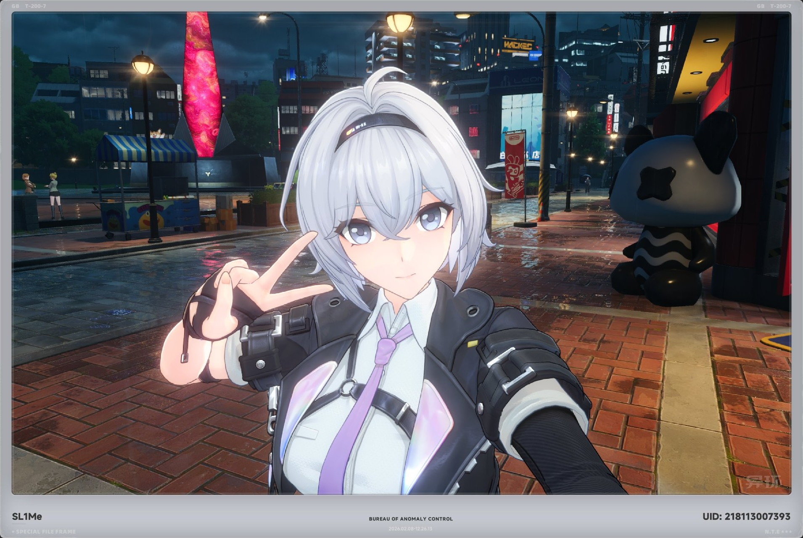
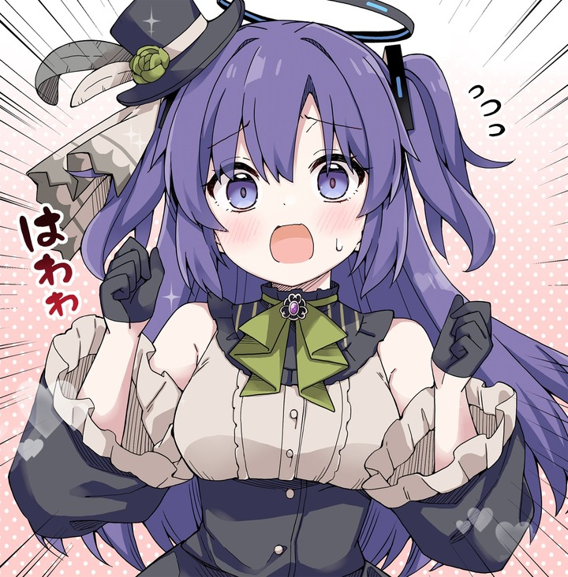
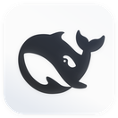
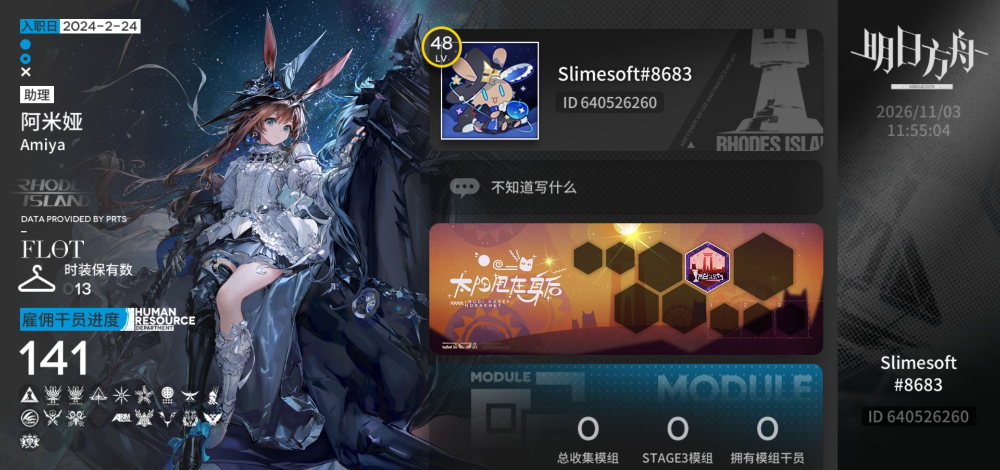

# ฅ(＾・ω・＾ฅ) 你好，我是 Slimeissoft！ ฅ(＾・ω・＾ฅ)

> 不知道怎么写先空着

<blockquote>
  
💭 苦逼大三金融学生

  
📁 最擅长的技能是新建文件夹

  
⏰ 最喜欢干的事情是明天再干

</blockquote>

<table border="0">
  <tr>
    <td valign="top" width="58%">
      
      
<b>现在在做</b>　PicFlow —— 一个不肯把图片传到别人服务器上的本地图库

      
<b>最近在写</b>　中文 / English / 日本語 三语的个人博客，零构建，CSS 全手写

      
<b>偷偷在做</b>　把一小时的播客，压成十分钟能读完的 skills

      
<b>闲的时候</b>　随便看看

    </td>
    <td valign="top" width="42%">
      
      

        放一只邮箱在这里……
      

    </td>
  </tr>
</table>

<!-- Snake Code Contribution Map 贪吃蛇代码贡献图（跑过 snake.yml 之后才会出现） -->
<picture>
  <source media="(prefers-color-scheme: dark)" srcset="https://raw.githubusercontent.com/Slimeissoft/Slimeissoft/output/github-snake-dark.svg" />
  <source media="(prefers-color-scheme: light)" srcset="https://raw.githubusercontent.com/Slimeissoft/Slimeissoft/output/github-snake.svg" />
  
</picture>

## 技能树 ψ(｀∇´)ψ

## 来找我玩吧 <(￣︶￣)↗[GO!]

&nbsp;&nbsp;&nbsp;

  

  

<a href="https://github.com/Slimeissoft/PicFlow"><b>PicFlow</b></a>　Windows 桌面图片整理应用 · Electron + AI 智能分类

  

## 近期博客 ☆*: .｡. o(≧▽≦)o .｡.:*☆

- 4月10日 - [QClaw 如何改变了我的工作方式——一个真实的使用感悟](https://slimeissoft.github.io/#/post/1)
- 4月05日 - [Seedance 2.0 与 Sora 2：AI 视频生成的新王者之争](https://slimeissoft.github.io/#/post/2)
- 3月28日 - [Gemma 4：Google 开源 LLM 迈入多模态时代](https://slimeissoft.github.io/#/post/3)

 

*写代码，也写过程。*

